# 👋 안녕하세요, 김채림입니다

**Full-Stack Developer (지망)** · 조선대학교 AI소프트웨어학부 정보보안전공 (2027.08 졸업 예정)

> 요구사항을 문서로 먼저 정리하고, 웹 서비스부터 엣지 AI 디바이스까지 **직접 만들고 끝까지 배포하는 것**을 좋아합니다.

- **보안을 먼저 생각합니다** — 키는 서버와 Secrets에만, 사용자 번호는 해시로만 저장하고, 입력은 서버에서 한 번 더 거릅니다.
- **AI를 쓰되 확인합니다** — AI가 고른 것은 규칙과 테스트로 검증하고, 사실과 다른 답은 내보내지 않습니다.
- **직접 써 보고 고칩니다** — 폰으로 말해 보고, 현장에서 걸어 보고, 실제 사이트를 눌러 보며 나온 문제를 바로 고칩니다.
- **결정은 기록으로 남깁니다** — 애매한 정책은 번호를 붙여 문서에 남기고, 기능 하나에 PR 하나로 나눠 올립니다.

 

## 📁 Portfolio

<table>
  <tr>
    <th width="50%">🍀 세잎지도 포트폴리오</th>
    <th width="50%">🙋 개인 소개 포트폴리오</th>
  </tr>
  <tr>
    <td align="center"><a href="./portfolio/safe-route-portfolio.pdf">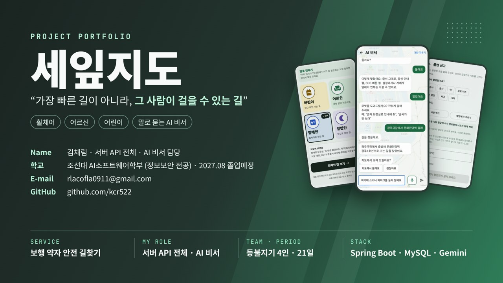</a></td>
    <td align="center"> <b>준비 중입니다</b>  </td>
  </tr>
  <tr>
    <td>보행 약자 안전 길찾기 · 서버 API 전체 · AI 비서 담당 · 16장 <a href="./portfolio/safe-route-portfolio.pdf">📄 PDF 보기</a></td>
    <td>자기소개 · 기술 · 경력 · 프로젝트 모음 곧 올릴 예정</td>
  </tr>
</table>

 

## 🛠 Tech Stack

| 분류 | 기술 |
|---|---|
| **Language** |        |
| **Backend** |     |
| **Frontend** |        |
| **Mobile** |   |
| **AI / Edge** |         |
| **Data / IoT** |      -FF6B00?style=flat-square&logoColor=white) |
| **Infra / DevOps** |      |
| **Tools** |      |

 

## 📌 한눈에 보기

| 프로젝트 | 한 줄 소개 | 기간 · 형태 | 주요 기술 |
|---|---|---|---|
| 🍀 **세잎지도** | 보행 약자에게 지금 상황에 맞는 길을 안내하는 길찾기 앱 | 2026.10 ~ 11 · 4인 팀 (서버 · AI 비서) | Java · Spring Boot · MySQL · Gemini |
| 📝 **blogproject** | 티스토리형 블로그 서비스 | 2026.10 · 4인 기획 / 구현 단독 | Spring Boot · Docker · Nginx · GitHub Actions |
| 🧹 **TIDY:** | 가계부·할 일·스크랩을 한곳에 모은 생활 정리 앱 | 2026.11 ~ · 개인 | React · TypeScript · Capacitor · Claude API |
| 📈 **timeseries-inference** | 엣지 시계열 예측·이상 탐지 서비스 | 2026.11 · 팀(Team 2) | Python · MQTT · TensorRT |
| 🧠 **embedding_gemma2** | Jetson 멀티모달 임베딩·비전 응용 | 2026.11 · 팀(Team 2) | PyTorch · EmbeddingGemma 2 · YOLO · GRU |
| 📷 **jetson-camera-applications** | Jetson 카메라 응용 실습 (과제 1~6) | 2026.11 · 팀(Team 2) | Python · TensorRT · YOLO · GRU · systemd |

---

## 📂 Projects

### 🍀 [세잎지도](https://github.com/Safe-Way/safe-route) — 상황 맞춤 보행 길찾기
`2026.10 ~ 11` `4인 팀 프로젝트` `서버 API 전체 · AI 비서 담당` `조선대 2026 AI·SW 캡스톤디자인 본선`

가장 빠른 길이 아니라 **그 사람이 실제로 걸을 수 있는 길**을 안내합니다. 어린이 · 어르신 · 휠체어 모드에 맞춰 계단 · 어두운 길 · 인도 없는 골목을 피하고, "문화전당 가자"처럼 **말로 물으면 AI 비서가 길을 찾아** 왜 이 길인지 쉬운 말로 설명합니다. 팀은 데이터 · 경로 엔진 · 서버 · 앱 네 파트로 나눴고, 저는 **서버 파트 전체**를 맡아 AI 비서, 대중교통 · 버스 · 장소 · 시설 · 신고 REST API, 날씨 · 미세먼지 상황 판단, 테스트 · 코드 품질 · 보안 점검까지 만들었습니다.

<table>
  <tr>
    <td align="center">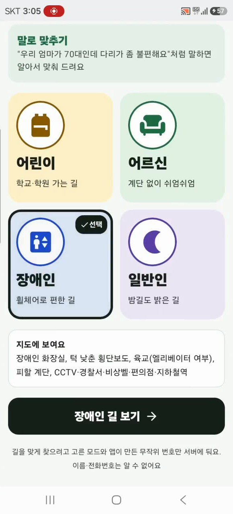 누가 걷는지 고르기</td>
    <td align="center">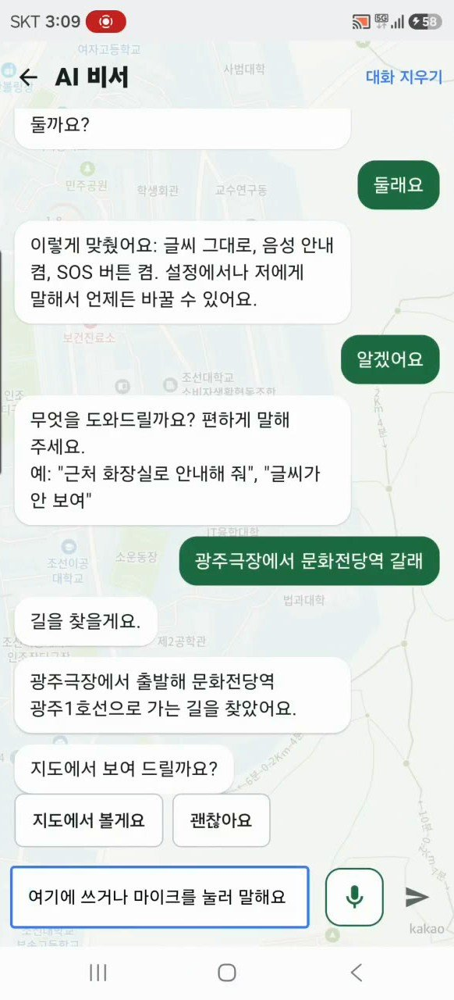 말로 묻는 AI 비서</td>
    <td align="center">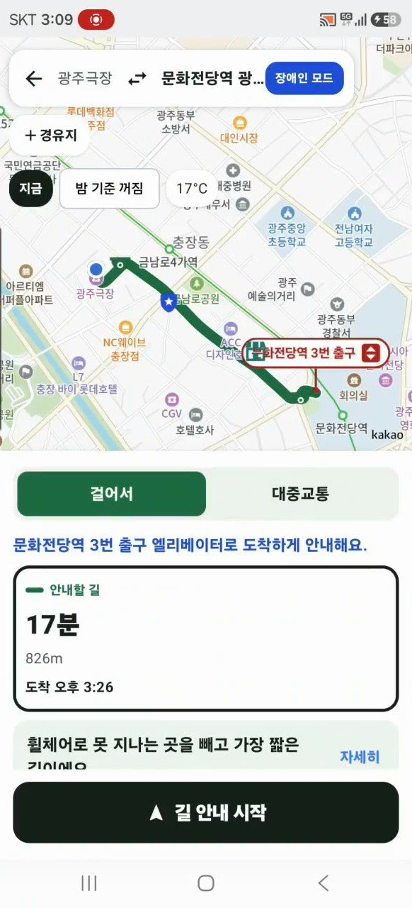 휠체어 맞춤 길</td>
    <td align="center">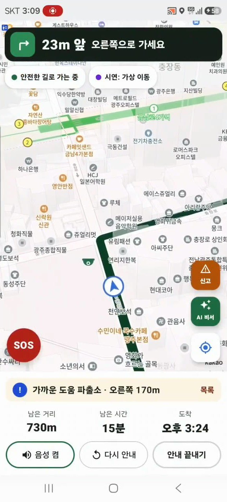 길 안내 · SOS</td>
    <td align="center">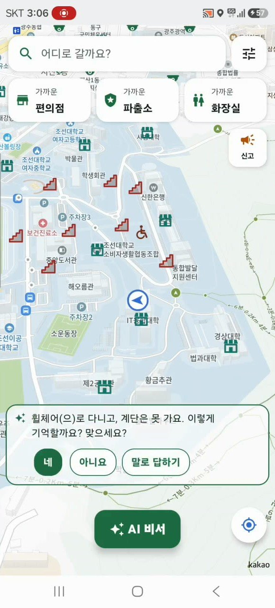 주변 안전 시설</td>
    <td align="center">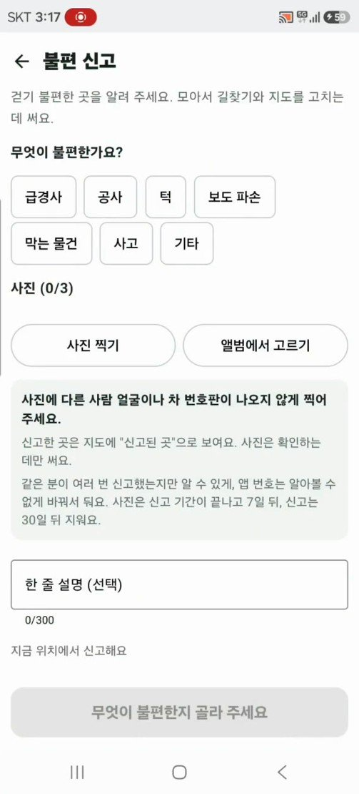 위험 신고</td>
  </tr>
</table>

**내가 한 일**
- **말로 묻는 AI 비서 API** (`POST /api/assistant`): 급한 말 · 들를 곳은 규칙이 먼저 답하고, 나머지는 Gemini 함수 호출로 도구(장소 찾기 · 길 추천 · 근처 찾기 등)만 고르게 함. 거리 · 시간은 우리 서버가 계산
- **AI 비용 줄이기**: 키워드 표로 필요한 도구만 보내고 규칙으로 답할 말은 AI를 부르지 않아 **입력 토큰 55% 절감** (83,385 → 37,583)
- **AI가 지어낸 말 막기**: 근거 없는 문장(예: 확인 안 된 턱을 피했다)은 빼고, 서버가 꼭 할 말을 붙여 사실대로 안내
- **상황 판단**: 날씨 · 미세먼지 · 밤 · 모드를 보고 걷기와 대중교통 중 추천, 비 오면 지붕 있는 길 안내
- **대중교통** (`POST /api/transit`): ODsay 경로 + 걷는 구간은 맞춤 길, 버스 도착 · 지하철 시간표, 휠체어는 엘리베이터 없는 역 제외
- **위험 신고** (`POST /api/reports`): 사진 검사(형식 · 크기), 신고자 번호는 HMAC 해시로만 저장, 보관 기간이 지나면 매일 자동 정리
- **음성 인식 보정**: 뜸 말 · 오타 정리, "광주역에서 다이소 갔다가 집으로"처럼 출발 · 들를 곳 · 도착 나눠 읽기
- **테스트와 코드 품질**: 내 파트 자동 테스트 685개, Spotless · Checkstyle · SpotBugs · JaCoCo 적용

**Stack** : Java 21 · Spring Boot · MySQL · Gemini API · 카카오 로컬 · ODsay · 공공데이터 API · JUnit5 · MockMvc · GitHub Actions · Docker

| 결과 | |
|---|---|
| AI 비서 입력 토큰 | 83,385 → 37,583 (**55%↓**) |
| 비서 시험 문장 63개 | 맞게 동작 44 → **56** |
| 비서 답 기다리는 시간 | 최대 10초 → **7초 한도** (넘으면 찾은 결과로 바로 답) |
| 현장 비교 (같은 코스 불편 수) | 세잎지도 **0** · 카카오 8 · 네이버 10 (팀 결과) |
| PR | 팀 서버 저장소 머지 298개 중 **90개** 작성 · 머지 |

---

### 📝 [blogproject](https://github.com/blogNM/blogproject) — 티스토리형 블로그 서비스
`2026.10` `4인 요구분석 → 구현 단독` `Claude Code`

4명이 함께 요구사항과 결정 기록(D-번호)을 문서로 정리하고, 그걸 바탕으로 혼자 구현부터 배포까지 맡았습니다.

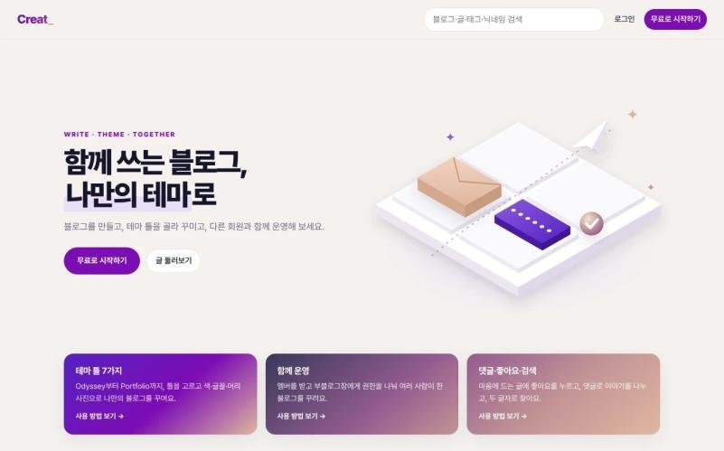

<table>
  <tr>
    <td align="center">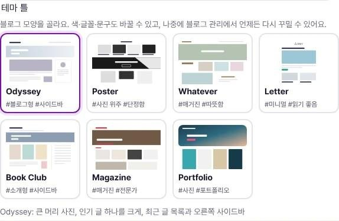 블로그 테마 7가지</td>
    <td align="center">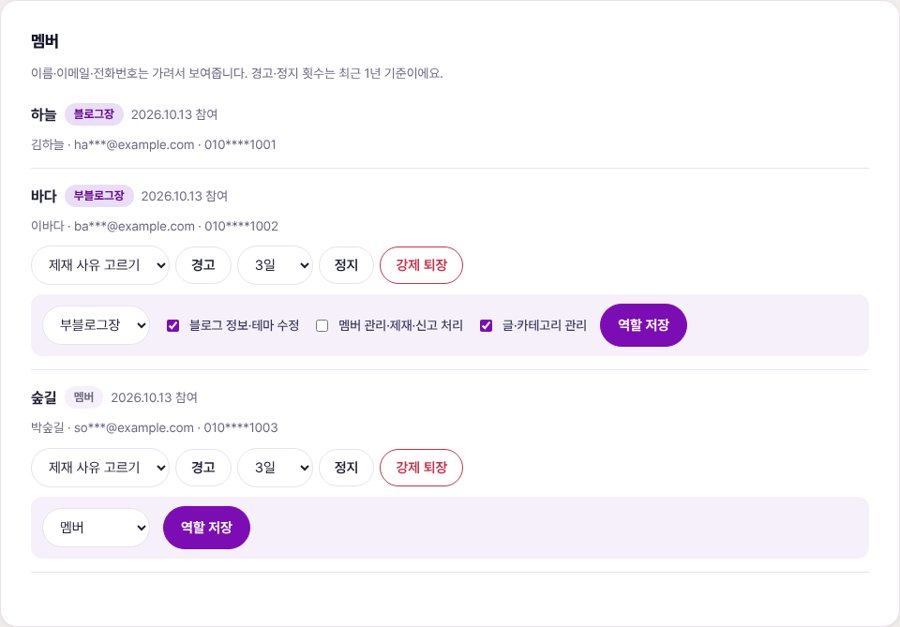 멤버 역할 관리</td>
    <td align="center">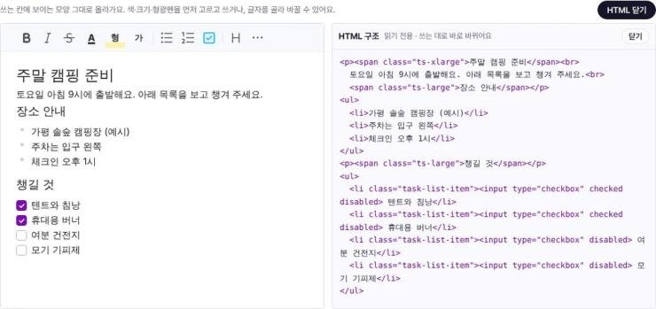 글 편집기</td>
    <td align="center">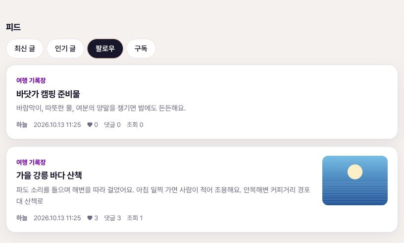 피드 · 팔로우</td>
  </tr>
</table>

**내가 한 일**
- GitHub Spec Kit 기능 명세(001~005)를 작성하고 그대로 구현
- 블로그 개설·가입·폐쇄, 게시판, 팔로우·구독·알림, 신고·관리자 처리, 방문 통계, 다크 모드, 욕설 필터, reCAPTCHA 봇 차단, 소셜 로그인 연동
- **Nginx 로드밸런서 + 앱 컨테이너 2대** 구성, GitHub Actions로 Docker 이미지 빌드·자동 배포
- **롤링 무중단 배포** 적용(v1.6.0), 일일 백업·복구 절차 마련

**Stack** : Spring Boot · HTML/CSS/JS · Toast UI Editor · Docker · Nginx · GitHub Actions

| 결과 | |
|---|---|
| 릴리스 | v1.0.0 → v1.15.2 |
| 커밋 | 140+ (PR 기반 작업) |
| 배포 | 롤링 무중단 배포 |

---

### 🧹 [TIDY:](https://github.com/kcr522/tidy) — 돈, 할 일, 읽을거리를 한곳에서 깔끔하게
`2026.11 ~ 진행 중` `개인 프로젝트` `Claude Code + GitHub Spec Kit`

가계부 앱, 할 일 앱, 북마크 앱을 따로 쓰다 보니 앱을 계속 옮겨 다녀야 했습니다. 세 가지를 앱 하나로 묶어 **첫 화면에서 이번 달 돈 흐름 · 오늘 할 일 · 안 읽은 스크랩**을 한눈에 보도록 만들고 있습니다.

[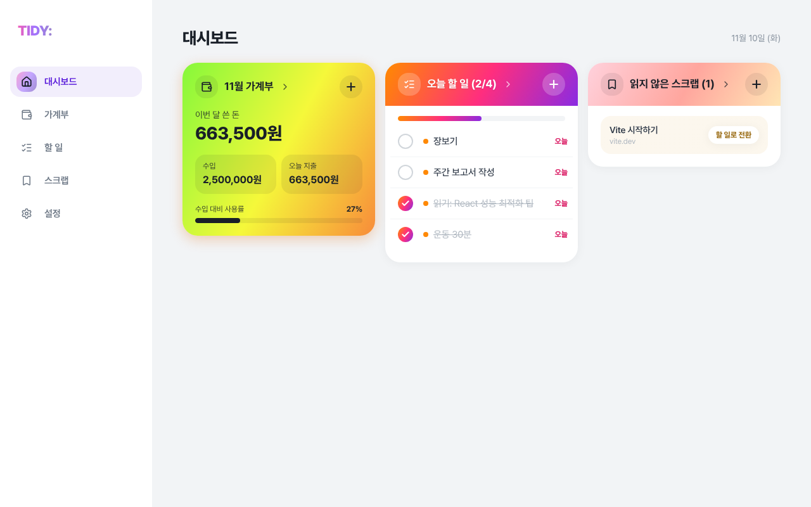](images/tidy/design-desktop.png)

대시보드 (컴퓨터) · 카드 색은 앱을 켤 때마다 랜덤 그라데이션

<table>
  <tr>
    <td align="center">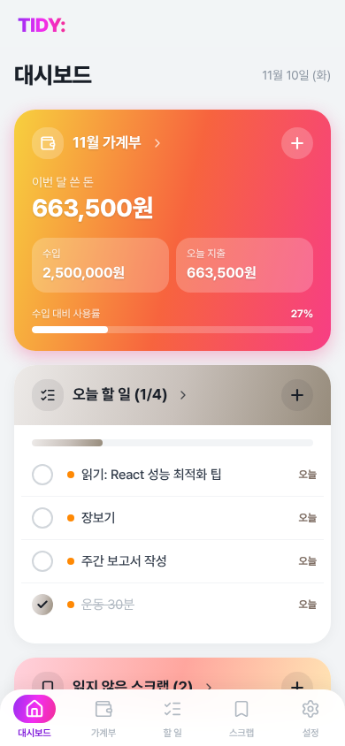</td>
    <td align="center">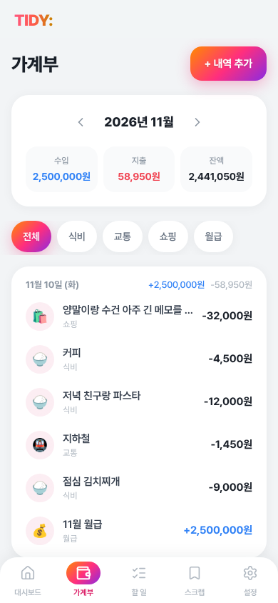</td>
    <td align="center">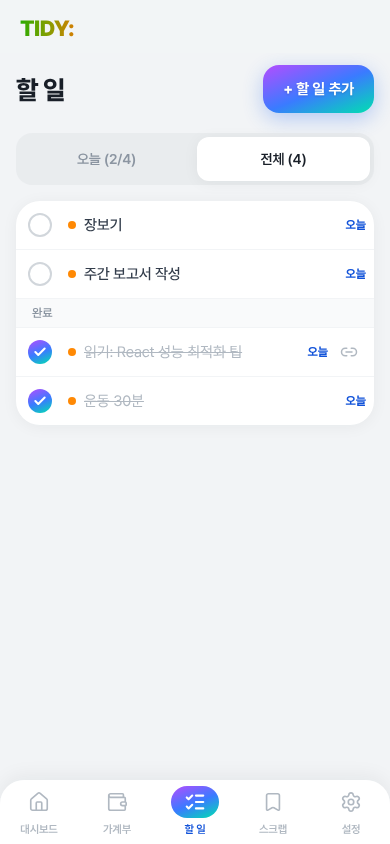</td>
    <td align="center">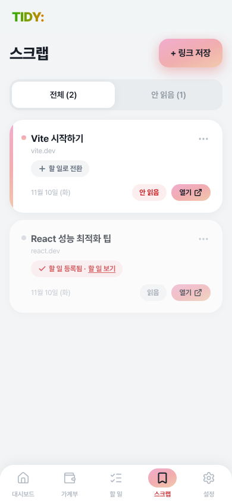</td>
  </tr>
  <tr>
    <td align="center">대시보드</td>
    <td align="center">가계부</td>
    <td align="center">할 일</td>
    <td align="center">스크랩</td>
  </tr>
</table>

**내가 한 일**
- Spec Kit으로 헌법(원칙 5개) → 요구사항 → 구현 계획 → **74개 작업 / 7일 스프린트**로 1차 MVP 완성
- **하나의 코드로 4개 환경** 지원: 폰 웹 · 컴퓨터 웹(PWA 설치) · Android/iOS 앱(Capacitor)
- **서버·로그인 없이** 기기 안 IndexedDB(Dexie.js)에 저장 → 인터넷 없이 동작, JSON 백업 내보내기/가져오기
- 스크랩 → 할 일 전환, 그 할 일을 끝내면 스크랩도 자동으로 읽음 처리하는 **기능 연동**
- **AI 비서** (Claude API + Vercel 서버 함수, API 키는 서버에만 보관): 포스터 사진 → 캘린더, 결제 캡처 → 가계부, 오늘 이야기 → 일기
- AI 없이도 쓰도록 **기기 안 OCR**(Tesseract.js)로 은행·카드 캡처를 읽어 가계부 입력
- GitHub Actions로 **Android APK 자동 빌드**

<table>
  <tr>
    <td align="center">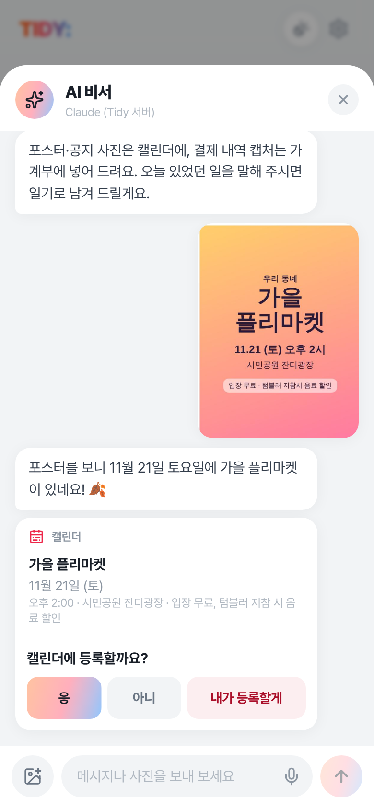</td>
    <td align="center">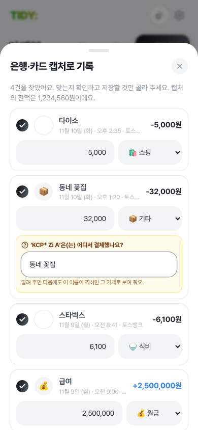</td>
  </tr>
  <tr>
    <td align="center">AI 비서 · 포스터 사진 → 캘린더 일정</td>
    <td align="center">기기 안 OCR · 캡처 → 가계부 (모르는 결제처는 물어보고 기억)</td>
  </tr>
</table>

**Stack** : React 19 · TypeScript · Vite · Tailwind CSS · Dexie.js · Capacitor · PWA · Claude API · Tesseract.js · Vercel · Vitest

| 진행 | 내용 |
|---|---|
| ✅ 1차 MVP | 가계부 · 할 일 · 스크랩 · 대시보드 · 백업 · PWA · 폰 앱 준비 |
| ✅ 2차 (일부) | 캘린더, 가게 로고, 정기 내역·월급 D-day, 차트·통계, 음식 사진 기록, 다크 모드, 적금 |
| 🛠 예정 | 구글 로그인 + 기기 간 동기화 |

---

### 📈 [timeseries-inference](https://github.com/AIP-1/timeseries-inference-AIGJ_01_005) — 엣지 시계열 추론 서비스
`2026.11` `팀 과제 (Team 2)` `Jetson Orin Nano Super`

센서 데이터를 MQTT로 모아 저장하고, 보드 한 대에서 **매분 CO₂ 60분 예측 · 이상 탐지 · 상태(환기/재실) 추정**을 돌리는 상주 서비스입니다.

**Stack** : Python · MQTT · PostgreSQL / SQLite / InfluxDB · TensorRT · systemd · REST API

| 항목 | 결과 |
|---|---|
| 수집 | 18시간 가동, 커버리지 99.4~99.9%, 재부팅·네트워크 단절에도 유실 없음 |
| 60분 예측 | 실측 데이터 MAE **34.5 ppm** (베이스라인 40.8) |
| 이상 탐지 | **87%** (13/15), 오탐 0.43회/일 |
| 엣지 최적화 | TensorRT FP32/FP16 비교 → 오차가 적은 FP32 채택 |
| 서비스 | 17.5시간 가동, 장애 테스트에서 알림·자동 복구 확인 |

---

### 🧠 [embedding_gemma2](https://github.com/AIP-1/embedding_gemma2-AIGJ_01_005) — Jetson 멀티모달 임베딩 · 비전 응용
`2026.11` `팀 과제 (Team 2)` `Jetson Orin Nano Super 8GB`

EmbeddingGemma 2를 8GB 보드에 올려 텍스트·영상·음성 임베딩을 돌리고, 객체 검색 · 동작 인식 · 카메라 2대 접근 감지까지 확장했습니다.

**Stack** : Python · PyTorch · EmbeddingGemma 2 · YOLO / YOLOE · GRU · 카메라 캘리브레이션

| 항목 | 결과 |
|---|---|
| 성능 | 전체 구성 8GB에서 실행, 텍스트 질의 158ms |
| 파인튜닝 | 강의실 문서 학습 → accuracy@1 **0.85 → 0.90** |
| 객체 검색 | 처음 보는 물체 3개: YOLO 0개 → relabel **3개 모두** 인식 |
| 동작 인식 | YOLO 포즈 + GRU, 처음 보는 사람 **13/15명(87%)** 인식 |
| 접근 감지 | 카메라 2대 캘리브레이션·스테레오로 거리 측정, 접근 알람 |

---

### 📷 [jetson-camera-applications](https://github.com/AIP-1/practice_task_for_jetson_camera_applications-AIGJ_01_005) — Jetson 카메라 응용 실습
`2026.11` `팀 과제 (Team 2)` `Jetson Orin Nano Super 8GB`

교육장 IP 카메라와 USB 웹캠을 보드에 연결해 카메라 연동 → 물체 인식 → 재실 인원 → 행동 인식 → 거리 측정 → 12시간 응용 서비스까지 6단계를 실제 카메라로 실측해 확인했습니다.

**Stack** : Python · TensorRT (FP16 / INT8) · YOLO / YOLOE · GRU · MQTT · systemd · RTSP

| 항목 | 결과 |
|---|---|
| 카메라 연동 | 지연 쌓이는 읽기 방식 찾아 고침(2분 뒤 96초 지연 → 증가 없음), 랜선 뽑아도 자동 재연결 |
| 물체 인식 | TensorRT FP16 추론 **5.1ms**(87fps), 선 통과 세기 **10/10** · MQTT 전송 |
| 재실 인원 | 0~2명 평균 오차 0.00~0.40명, ±1명 **100%**, 빈 방 오판 0% |
| 행동 인식 | 만세 10/10 · 행동 11/12, 처음 보는 사람 **87%**, 깜빡임 12 → 0 |
| 거리 측정 | 웹캠 1대를 8cm 옮겨 찍는 방식으로 1.4m → 1.35m (오차 −3.6%) |
| 응용 서비스 | **12시간** 넘게 재시작 0, 영상 저장 0(개인정보), 재부팅 뒤 1~2분 복귀 |
| 심화 | 1080p 하드웨어 디코딩 CPU 65~94% → **12%**, 세 프로그램 합쳐 메모리 3,356 → **1,693MB** |

---

## 📜 Certificates & Activities

| 시기 | 내용 |
|---|---|
| 2026.09 | **DSAC 3급 프로그래머** 취득 |
| 2025-2 | 블루밍 멘토링 멘티 |
| 2025.08 | 영·호남 4개 대학 연합 미래모빌리티 취업캠프 **A조 1등** |
| 2025-1 | **빅데이터 실무 활용능력** 취득 |

---

## 🗓 Timeline

| 시기 | 내용 |
|---|---|
| 2027.08 | 🎓 졸업 예정 |
| 2026.11 ~ | 🧹 TIDY: (개인) 진행 중 |
| 2026.10 ~ 11 | 🍀 세잎지도 (4인 팀, 서버 · AI 비서) · 조선대 2026 AI·SW 캡스톤디자인 본선 발표 |
| 2026.11 | 📈 timeseries-inference · 🧠 embedding_gemma2 · 📷 카메라 응용 (Jetson 수업 과제) |
| 2026.10 | 📝 blogproject 개발 · 배포 |

---

## 🎓 Education

- 조선대학교 AI소프트웨어학부 (정보보안 전공) · 2027.08 졸업 예정

## 📫 Contact

- ✉️ rlacofla0911@gmail.com
- 🔗 [github.com/kcr522](https://github.com/kcr522)

---

## 📊 GitHub Stats

  
  

